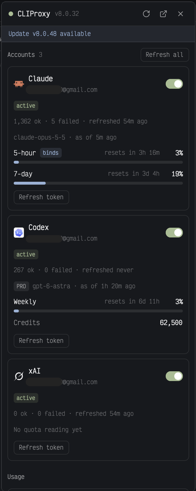

# CLI Proxy Lite

A floating window for a [CLIProxyAPI](https://github.com/router-for-me/CLIProxyAPI) server: whether it's reachable, each account's status and quota (Claude's 5-hour and 7-day windows, Codex's weekly window and credits), usage per upstream and the newest error logs. It also runs the everyday actions: enable or disable an account, refresh tokens, reset cooldowns. Rare admin work (config, OAuth logins, plugins) opens the server's own web UI, the [CLIProxyAPI Management Center](https://github.com/router-for-me/Cli-Proxy-API-Management-Center), instead. It's the smaller sibling of [CLI Proxy](../cliproxy/), which adds live quota from each provider, a health verdict and sign-ins: install one or the other. It's a piece you add to your current layout: nothing in the layout changes.



## What you see

- **The window:** 340px wide and 90% of the window's height, in Herdr's window frame. **Ctrl+Shift+X** opens it. Drag it by its header; it stays where you drop it and comes back on the next start until you close it. Text is 13px, with your theme's colors throughout.
- **Header**, 42px, bottom border: an 8px status dot (`ansi2` green when the server answers, `ansi1` red when it doesn't, `dim` while connecting or logged out), **CLI Proxy Lite** semibold, then the server version (`v8.0.32`, 11px, `dim`). On the right, 26px icon buttons: Refresh (spins while loading), Open web UI, and × close.
- **Update strip**, 28px, `accent` text on an `accent` tint: "Update v8.0.48 available" when the server's latest version is newer. Clicking it opens the web UI.
- **Problem banner**, `ansi1` text on an `ansi1` tint: "Proxy unreachable · no answer in 15 s", "Management key refused" or "Proxy error · 500: …". It has **Change key** (when refused) or **Change URL**, and **Retry**. The data underneath stays but fades to 45%.
- **Body**, scrolling, 10px padding, 16px between sections. Section labels are 11px semibold `muted` with a count.
- **Accounts:** one card per credential (`surface`, 1px `border`, radius 8, 10px padding).
  - The provider's icon (18px, Herdr's `icons/<provider>.svg`; `xai` uses Grok's, tinted) or a letter tile, the provider's name, its label or email (11px `dim`), and a 30×17 switch (`ansi2` when enabled).
  - Chips (10px): the status (`ansi2` when active, else `blocked`), "disabled", "unavailable" (`ansi1`), and "cooling 4m" (`blocked`) while a cooldown runs. Hovering the cooldown chip lists each one's model and reason. The status message, if any, follows.
  - "1,274 ok · 4 failed · refreshed 17m ago" (11px `dim`).
  - Quota, from the newest reading across the account's models: "claude-opus-5-5 · as of 3m ago", then one bar per window. A bar row has the window's name, a **binds** chip on the window the server says binds, a chip with the status when it isn't `allowed`, "resets in 3h 53m" and the percentage, over a 5px track. Up to 70% is `accent`, 70–90% `blocked`, over 90% (or a status other than `allowed`) `ansi1`. A window whose reset has passed fades to 55% and says "window reset since".
    - Claude: 5-hour, 7-day, any other unified window, and Overage only when it's above 0.
    - Codex: a plan chip (PRO), the primary window (10080 minutes is "Weekly"), the secondary one only when its window is above 0, and Credits unless they're unlimited.
    - Other providers: the raw signals as key/value lines.
  - 24px buttons: **Refresh token**, and **Reset cooldown** while cooling.
  - "Refresh all" sits on the Accounts label's right.
- **Usage:** one card per upstream: the provider's name, the upstream's host only (never its hash or credentials), "10 ok · 143 failed" and the failure rate (50% and up `ansi1`, 10% and up `blocked`, else `muted`). Then a 26px sparkline of the last 20 ten-minute buckets (failed `ansi1` stacked on success `ansi2`; empty buckets are a 1px `border` line; each has a tooltip), with the first and last times under it.
- **Errors:** the 10 newest error logs, 26px rows: the name without `.log`, ellipsized in the middle, and how long ago. Hidden when the server returns 400 for the list.
- **Footer**, 10px `dim`: "Connected to host:8317 · Log out", then "Updated just now · every minute".
- **Login**, in place of the body when there's no server or key, after Log out, or from Change key / Change URL: "Log in to CLI Proxy Lite" (16px semibold) and a line of explanation; Server URL and Fallback URL (optional) fields, or "Current URL" read-only with a **Change** link once one is saved; Management key, masked, with an eye to show it; a **Remember key** checkbox ("Saved to ~/.config/cliproxyapi/mgmt.key, readable only by you", or "Kept in memory until Herdr restarts; a saved key is removed"); any error in `ansi1`; a full-width 34px **Log in** button (`solid`); and Cancel when it was already set up.
- **Error log pane:** a pane with an "Error log" header and the log's name, then a read-only code view.

## How it behaves

- There are no agent statuses here. It asks the server every 60 seconds (also while hidden), right after any action, and on Refresh. It checks the latest version, and reads the server's version, every 30 minutes.
- Each request has 15 seconds. A request that can't reach the server, or a read that times out, tries the fallback URL. An action that times out isn't retried: it may have landed.
- **Switch:** `PATCH /credentials/status {name, disabled, auth_index}`. **Refresh token:** `POST /credentials/refresh {name, auth_index}`. **Refresh all:** `POST /credentials/refresh {all: true}`, waiting up to 5 minutes with a braille spinner. **Reset cooldown:** `POST /routing/cooldown/reset {auth_index}`. A failure shows a toast; the data refreshes either way.
- A refused key (401 or 403) stops the polling for that key until it changes or you press Retry: the server bans addresses after repeated bad keys.
- Clicking an error log opens it in a read-only pane to the right of the focused pane (a tab when no pane has focus). Authorization, cookie and API-key headers, bearer tokens, token-like JSON fields and `key=` query values are replaced with `[redacted]`.
- **Log in** cleans the URL (drops a path such as `/management.html`; a bare host like `proxy` becomes `http://proxy:8317`), then tries `GET /credentials` with the key. Only a working pair is saved: the URL to `~/.config/herdr-app/cliproxy.json`, and with Remember the key to `~/.config/cliproxyapi/mgmt.key` (folder 700, file 600). Without Remember the key stays in memory and any saved key file is deleted. A blank key field uses the saved key.
- **Log out** forgets the key (the file and memory) and keeps the URL, as the web UI's does.
- **Open web UI** opens the Management Center the server hosts at `<server>/management.html`, with `open` on macOS or `xdg-open` elsewhere, and falls back to the system's URL opener.
- Ctrl+Shift+X opens the window, or replaces an open one in place. × closes it.

## Built from

- **One mod**, `mods/cliproxy-lite/`:
  - `mod.json`: `{ "place": "none", "title": "CLI Proxy Lite", "overlay": { "kind": "window", "key": "cliproxy-lite", "keep": true, "width": 340, "height": 0.9 } }`. No layout change.
  - `api.js`: the client (`fetch` with a Bearer header, a 15 s race against `cx.sleep`, falling back to the second URL), the config and key files, the parsing (`cleanFile` keeps only the fields shown), URL cleanup, redaction and time formatting.
  - `main.js`: the view, the login form, the actions and the log pane (the same mod with `props: { log }`).
  - Icons drawn after Lucide, tinted: `refresh`, `external`, `x`, `eye`, `eye-off`, `check`.
- **A `keys.json` snippet**, merged into the person's keys:

  ```json
  {
    "global": { "ctrl-shift-x": "mod.open:cliproxy-lite" },
    "terminal": { "ctrl-shift-x": "mod.open:cliproxy-lite" }
  }
  ```

- **Herdr:** `exec`, `run` (`pane.split`, `tab.new`), `notify`, `closeOverlay`, `props`, `focused`, `theme`, `settings`, `window`, `readTextFile`, `writeTextFile`, `home`, `appHome`. **gpui:** `InputState` with `set_masked`, `Input`, `EditorState` and `Editor`, `.frames`, `.spin`, `.transition`, `.tooltip`, `svg` and `image`.
- **The server's management API**, as [CLIProxyAPI](https://github.com/router-for-me/CLIProxyAPI) serves it and the [Management Center](https://github.com/router-for-me/Cli-Proxy-API-Management-Center) uses it (base `/v8/management`): `GET /credentials`, `/observability/usage/api-keys`, `/observability/logs/errors`, `/observability/logs/errors/<name>`, `/server/latest-version`; `PATCH /credentials/status`; `POST /credentials/refresh`, `/routing/cooldown/reset`. The version comes from the `X-CPA-Version` / `X-Server-Version` response header, read with `net.connect` and a plain HTTP request carrying the same key.
- **Programs:** `mkdir` and `chmod` for the key folder and file, `rm -f` for the key file only, and `open` or `xdg-open`.

## Watch out

- Never call `GET /config`, `/config.yaml` or `/credentials/download` (they return client API keys and OAuth tokens), and never call `DELETE` endpoints. Never show `id_token`, `path` or any field not listed above; Codex entries carry an `id_token`.
- Never put the key in the code, props, `localStorage`, logs or the UI.
- Herdr's `fetch` gives no response headers, so the version needs the socket request. That's plain http only: an https server shows no version.
- Every quota value is a string (`"0.19"`, `"True"`). Resets are unix seconds. `observed_at` and `last_refresh` have nanoseconds, which `Date.parse` refuses: cut them to milliseconds first.
- `model_quotas` has an entry per model, some days old. Show the newest.
- `writeTextFile` makes new files and folders readable by everyone: create the folder with `mkdir -m 700` and `chmod 600` the key file after writing.
- In a window, any press the mod doesn't stop drags the window. Stop mouse-down on every control and on the body so only the header drags.
- Herdr doesn't live-reload a mod folder that's a symlink: install by copying.
- The log pane is a separate copy and can't see a key kept only in memory: opening logs needs Remember key.
- Limits: 10 error logs, 20 sparkline buckets, logs cut at 400,000 characters, countdowns updated once a minute.
- `GET /observability/logs` returns 400 when the server doesn't log to file, so there is no general log view.
- Built and tested on macOS. Linux uses `xdg-open`; on Windows, saving the key fails (no `mkdir -m` / `chmod`).
- The mod reaches the network (your server), runs the programs above, and reads and writes the two files above.

## Done when

- `herdr-app check mods/cliproxy-lite` passes.
- Ctrl+Shift+X opens the window. With no `cliproxy.json` it shows the login form.
- Logging in with a working URL and key shows the accounts and writes `cliproxy.json`. With Remember, `mgmt.key` is 600 in a 700 folder; without it, there's no key file.
- A wrong key says "The server refused that key"; an address that doesn't answer says "Can't reach …". Neither saves anything.
- A Claude account shows 5-hour and 7-day bars with one marked binds; a Codex account shows the weekly bar and credits.
- Turning an account off and on round-trips, and the web UI shows the same state.
- With the server unreachable, the dot turns red, the banner says "Proxy unreachable" and the old data fades; it recovers on the next poll or Retry, without reopening.
- Clicking an error log opens a pane with any Authorization header redacted.
- Log out brings back the login form with the current URL, and the key file is gone.
- It's readable in both light and dark themes.
