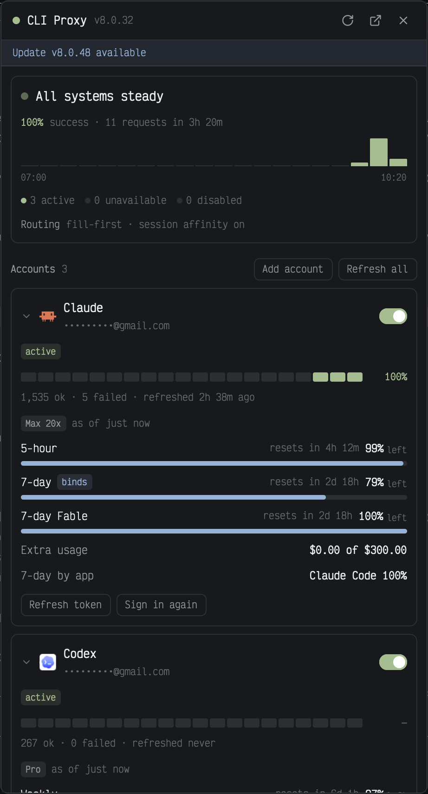

# CLI Proxy

Press Ctrl+Shift+X for the [CLIProxyAPI](https://github.com/router-for-me/CLIProxyAPI) [Management Center](https://github.com/router-for-me/Cli-Proxy-API-Management-Center)'s day-to-day view as a Herdr pane — its own tab, or a page beside your work like the Files panel: a health verdict with success rate and throughput, live quota as each provider reports it (plan, what's left in each window, extra usage, credits), every account's recent requests, API-key upstreams and the newest error logs. Sign accounts in, turn them on or off, refresh tokens, reset cooldowns and set the server's everyday settings — routing, logging, management access — from it; routing tiers, plugins, keys and anything that spends reset credits stay in the Management Center. The fuller sibling of [CLI Proxy Lite](../cliproxy-lite/): it's one or the other, and both share one login. Nothing in your layout changes until you open it.



## What you see

- **The pane:** **Ctrl+Shift+X** opens it as its own tab (`tab.new {name: "CLI Proxy", mod: "cliproxy"}`); a layout can also hold it as a side-panel page like the Files panel — same mod, whatever pane it's given. It fills the pane's width; text is 13px, with your theme's colors throughout. In a tab, closing the tab closes the view; a hidden panel copy keeps running and comes back as it was.
- **Header**, 42px, bottom border: an 8px status dot (`ansi2` when the server answers, `ansi1` when it doesn't, `dim` while connecting or logged out), **CLI Proxy** semibold, the server version (`v8.0.32`, 11px `dim`), then 26px icon buttons: Refresh (spins while loading), Server settings (a sliders glyph, in `accent` while its view is open), Open web UI, and × close.
- **Update strip**, 28px, `accent` text on an `accent` tint: "Update v8.0.48 available". Clicking it opens the web UI.
- **Problem banner**, `ansi1` on an `ansi1` tint: "Proxy unreachable · no answer in 15 s", "Management key refused" or "Proxy error · …", with **Change key** (when refused) or **Change URL**, and **Retry**. The data underneath stays and fades to 45%.
- **Body**, scrolling, 10px padding, 16px between sections. Section labels are 11px semibold `muted` with a count.
- **Health card** (`surface`, 1px `border`, radius 8, 10px padding):
  - An 8px dot that pulses gently while there's traffic, and the verdict in 14px semibold: "All systems steady" (`ansi2`, 95% success and up), "Minor turbulence" (`blocked`, 80% and up), "Needs attention" (`ansi1`, below 80%), or "Quiet for now" (`dim`, no requests).
  - "98.8% success · 328 requests in 3h 20m", the rate in the verdict's color.
  - A 30px throughput chart of the 20 ten-minute buckets, every account and API-key upstream added up: failed (`ansi1`) stacked on success (`ansi2`); empty buckets are a 1px `border` line; each bucket has a tooltip; the first and last times sit under it.
  - "● 3 active · ● 0 unavailable · ● 0 disabled", each dot lit only when its count is above 0.
  - "Routing fill-first · session affinity on" (11px, "Routing" in `muted`): the strategy, session affinity and retries, only those the server's config sets.
- **Accounts:** one card per credential, with **Add account** and **Refresh all** on the section label's right. Each card folds: a 12px chevron (`dim`) sits before the icon, and clicking the chevron, icon or name opens or closes it. A folded card keeps the header, chips, request strip and totals line; quota and buttons show only when it's open. Cards start open.
  - The provider's icon (18px, Herdr's `icons/<provider>.svg`; `xai` uses Grok's, tinted) or a letter tile, the provider's name, its label or email (11px `dim`), and a 30×17 switch (`ansi2` when enabled).
  - Chips: the status (`ansi2` when active, else `blocked`), "disabled", "unavailable" (`ansi1`), "cooling 4m" (`blocked`, its tooltip lists each cooldown's model and reason), then the status message.
  - **Request strip:** 20 segments of 10px, one per ten-minute bucket, colored by that bucket's success rate with the verdict's thresholds (`raised` when empty), each with a tooltip; the window's success rate on the right. Under it: "1,408 ok · 5 failed · refreshed 1h 10m ago" (all-time counts, when the token was last refreshed).
  - **Quota:** a plan chip (Max 20x, Pro, X Premium+) and "as of just now", with a braille spinner while it loads. Then one bar per window: its name, a **binds** chip on the window that limits the account now, a chip when the provider flags it (`warning`, `critical`, `limit reached`), "resets in 3h 0m", and "**95%** left". The 5px bar fills with what's left: `accent` while at least 30% is left, `blocked` from 30% to 10%, `ansi1` below 10% or when flagged critical. A window whose reset has passed fades to 55% and says "window reset since".
    - Claude: 5-hour, 7-day, 7-day Opus / Sonnet / OAuth apps / Cowork when the account has them, and per-model weekly limits such as 7-day Fable. Then "Extra usage $0.00 of $300.00" (or "off") and "7-day by app Claude Code 100%".
    - Codex: the primary window (604800 seconds is "Weekly"), the secondary one only when it has a length, "Credits 62,500" (or "unlimited") and "Reset credits 1" when there are any.
    - xAI: "Period resets in 3d 10h", "Pay as you go off", and "xAI reports no usage percentage".
    - If the live reading fails: "Live quota unavailable · 401: …" in `blocked`, and the last reading stays. With no live reading at all, CLI Proxy Lite's reading from response headers on the account's own traffic shows instead, as "claude-opus-5-5 · from traffic 3m ago".
  - 24px buttons: **Refresh token**, **Sign in again** (Claude, Codex, xAI, Antigravity, Kimi and Muse accounts), and **Reset cooldown** while cooling.
- **Add account** opens a card at the top of the section: "Add an account", a button per provider (Claude, Codex, xAI, Antigravity, Kimi (kimi.com), Kimi (kimi.ai), Muse (Meta)), Cancel, and "Devin, Vertex and plugin sign-ins are in the web UI."
- **Sign-in card**, in the same place while a sign-in runs (one at a time), with an `accent` border (`ansi1` on failure): "Add a Claude account" or "Sign in to Claude again" with "as you@example.com · another account is refused", and Cancel.
  - Starting: a spinner and "Starting sign-in…".
  - Browser sign-ins (Claude, Codex, xAI, Antigravity): "Finish signing in in your browser. If it ends on a page that won't load, copy that page's address and paste it here.", a 30px field and **Send**; then "Address sent; finishing the sign-in…", or what the server said.
  - Device sign-ins (Kimi, Muse): "Your browser opened the provider's page. Enter this code there:", the code in 18px semibold monospace, and **Copy code**.
  - While waiting: a spinner and "Waiting for the sign-in", **Open page again** and **Copy link**.
  - Done: "Signed in. The new account will appear below." (or "Signed in again…") in `ansi2`; the card goes after 5 seconds. Failed: the reason in `ansi1` and **Try again**.
- **API-key upstreams** (shown only when there are any): one card each with the provider's name, the upstream's host only (never its hash or credentials), "10 ok · 143 failed", the failure rate (50% and up `ansi1`, 10% and up `blocked`) and a 26px chart like the health card's.
- **Errors:** a folding section, closed at first: the header is a chevron, "Errors", the count and, while closed, "newest 7m ago". Open, it lists the 10 newest error logs in 26px rows: the name without `.log`, ellipsized in the middle, and how long ago. Hidden when the server returns 400 for the list.
- **Footer**, 10px `dim`: "Connected to host:8317 · Log out", then "Updated just now · every minute, quota every 5".
- **Server settings**, in place of the body while open: a bar with **Back**, "Server settings", "saved just now" after a save, **Revert** while something changed, and **Save** (solid when something changed, "Up to date" when not, "Saving…" with a spinner during). Three cards of rows: **Routing** — Strategy as three buttons (Round-robin, Weighted, Fill-first, each with a tooltip), Session affinity, Affinity lasts (a duration like `1h`), Request retries, Retry wait (seconds), Disable cooldowns, Require model prefix; **Logging & usage** — Debug logging, Log to files, Record requests, Error logs kept, Usage statistics; **Management access** — Allow remote (a `blocked` warning under it while off) and Disable web UI. Switches sit right of their labels; numbers and durations type into small fields whose border turns `ansi1` with the reason under them when invalid. Under the cards: "Keys, routing tiers, plugins and TLS stay in the web UI." with an Open web UI link.
- **Login**, in place of the body when there's no server or key, after Log out, or from Change key / Change URL: "Log in to CLI Proxy", Server URL and Fallback URL (optional) fields or "Current URL" read-only with **Change**, Management key (masked, with an eye), **Remember key**, any error in `ansi1`, a full-width 34px **Log in** button (`solid`), and Cancel when it was already set up.
- **Error log pane:** a pane with an "Error log" header and the log's name over a read-only code view.

## How it behaves

- The accounts, upstreams, error list and routing line refresh every 60 seconds (also while hidden), right after any action, and on Refresh. The latest version and the server's version are checked every 30 minutes.
- **Live quota** is fetched per enabled Claude, Codex or xAI account when the window opens, on Refresh, and at most every 5 minutes after that, each in its own task, so the cards show first and their quota fills in. Plans are asked for at most hourly. Disabled accounts aren't asked ("Quota not checked while disabled").
- Each request has 15 seconds, and each quota request 20. A read that can't reach the server tries the fallback URL; an action that times out isn't retried.
- **Switch:** `PATCH /credentials/status {name, disabled, auth_index}`. **Refresh token:** `POST /credentials/refresh {name, auth_index}`. **Refresh all:** `POST /credentials/refresh {all: true}`, waiting up to 5 minutes with a spinner. **Reset cooldown:** `POST /routing/cooldown/reset {auth_index}`. A failure shows a toast; the data refreshes either way.
- **Sign-in:** `GET /oauth/auth-url?provider=<id>` (with `&is_webui=true` for browser sign-ins, `&auth_index=<index>` to sign an account in again) gives `{url, state, user_code?, expires_in?}`. The link opens in the browser at once. `GET /oauth/status?state=<state>` is asked every 3 seconds until `ok` or `error`, or until `expires_in` (else 15 minutes) runs out. A pasted address goes to `POST /oauth/callback {provider, redirect_url}`, as pasted except for xAI: when Grok shows only a code or a bare query, it's rebuilt as `http://127.0.0.1:56121/callback?state=<state>&code=<code>`. **Cancel** sends `DELETE /oauth/session?state=<state>`, which only ends that pending sign-in. Success refreshes the accounts. The server's optional test request after sign-in (`verify`) is never asked for: it spends tokens.
- **Server settings** (the gear): opened, it reads the four secret-free config paths — `GET /config/routing`, `/config/observability`, and the management leaves `allow-remote` and `disable-control-panel` (a missing leaf is the server's default). **Save** sends one PATCH per changed group: routing and observability as the server's own object with the changed leaves replaced, management as its changed leaves only — the management secret is never read or sent. It then reads everything back (the fields show what the server kept), toasts which groups saved, and refreshes the panel, so the health card's routing line follows. A field the server omits stays omitted unless it's changed; defaults are never written just by opening the view. A successful write also saves the server's config file in the v8 layout, its own migration. **Revert** drops the edits and retypes the fields; **Back** closes the view. Logging out or switching servers closes it too.
- A refused key (401 or 403) stops the polling for that key until it changes or you press Retry: the server bans addresses after repeated bad keys.
- Clicking an error log opens it in a read-only pane to the right of the focused pane (a tab when no pane has focus), with authorization, cookie and API-key headers, bearer tokens, token-like JSON fields and `key=` query values replaced by `[redacted]`.
- **Log in** cleans the URL (drops a path such as `/management.html`; a bare host like `proxy` becomes `http://proxy:8317`) and tries `GET /credentials` with the key. Only a working pair is saved: the URL to `~/.config/herdr-app/cliproxy.json`, and with Remember the key to `~/.config/cliproxyapi/mgmt.key` (folder 700, file 600). Without Remember the key stays in memory and any saved key file is deleted. A blank key field uses the saved key. **Log out** forgets the key and keeps the URL. These are the same files CLI Proxy Lite uses.
- **Open web UI** opens `<server>/management.html` (the Management Center) with `open` on macOS or `xdg-open` elsewhere, falling back to the system's URL opener.

## Built from

- **One mod**, `mods/cliproxy/`:
  - `mod.json`: `{ "place": "none", "title": "CLI Proxy" }` — nothing docks itself; the key (or a layout block) puts it somewhere.
  - `api.js`: the client (`fetch` with a Bearer header, a 15 s race against `cx.sleep`, falling back to the second URL), the config and key files, parsing (`cleanFile` keeps only the fields shown, plus each account's `recent_requests` buckets), URL cleanup, redaction, times, and the header-quota readers.
  - `quota.js`: live quota through `POST /requests/api-call` and its parsers, and `headerQuota` for the fallback.
  - `signin.js`: the sign-in providers, the auth-url query, the xAI callback rebuild and the routing line.
  - `settings.js`: the settings groups and their config paths, the read of the four whitelisted paths, typed-field validation, and the changed-groups diff that builds the PATCH bodies.
  - `main.js`: the view, health card, login form, sign-in card, settings view, actions and log pane (the same mod with `props: { log }`).
  - Icons drawn after Lucide, tinted: `refresh`, `sliders`, `external`, `x`, `eye`, `eye-off`, `check`, `chevron-right`, `chevron-down`.
- **A `keys.json` snippet**, merged into the person's keys (the same key as CLI Proxy Lite's: install one or the other):

  ```json
  {
    "global": { "ctrl-shift-x": { "command": "tab.new", "args": { "name": "CLI Proxy", "mod": "cliproxy" } } },
    "terminal": { "ctrl-shift-x": { "command": "tab.new", "args": { "name": "CLI Proxy", "mod": "cliproxy" } } }
  }
  ```

- **Herdr:** `exec`, `run` (`pane.split`, `tab.new`), `notify`, `closeOverlay`, `props`, `focused`, `theme`, `settings`, `window`, `readTextFile`, `writeTextFile`, `home`, `appHome`. **gpui:** `InputState` with `set_masked`, `Input`, `EditorState` and `Editor`, `.frames`, `.spin`, `.loop`, `.transition`, `.tooltip`, `svg` and `image`; `localStorage` for which cards are folded and whether Errors is open (it can be missing: folding then lasts the session).
- **The management API** (base `/v8/management`), as CLIProxyAPI serves it and the Management Center uses it: `GET /credentials`, `/observability/usage/api-keys`, `/observability/logs/errors`, `/observability/logs/errors/<name>`, `/server/latest-version`; `PATCH /credentials/status`; `POST /credentials/refresh`, `/routing/cooldown/reset`, `/requests/api-call`; `GET /config/routing` and, for the settings view, `GET /config/observability`, `GET /config/management/allow-remote`, `GET /config/management/disable-control-panel` and `PATCH /config/routing`, `/config/observability`, `/config/management`; and for sign-in `GET /oauth/auth-url`, `GET /oauth/status`, `POST /oauth/callback`, `DELETE /oauth/session`. The version comes from the `X-CPA-Version` / `X-Server-Version` response header, read with `net.connect` and a plain HTTP request carrying the same key.
- **`/requests/api-call`** takes `{auth_index, method: "GET", url, header}` and returns `{status_code, header, body}` (the body as a string). The server puts the account's token where the header says `Bearer $TOKEN$`. The console sends only these, with the Management Center's headers:
  - Claude: `https://api.anthropic.com/api/oauth/usage` (windows: `utilization` 0–100 and `resets_at`; `limits[]` with `kind`, `percent`, `severity`, `is_active`, `scope.model.display_name`; `spend` in minor units; `seven_day_breakdown.rows`) and, hourly, `/api/oauth/profile` (only `organization.rate_limit_tier`, `organization_type`, `subscription_status`, `account.has_claude_max` / `has_claude_pro` are read). Headers: `User-Agent: claude-cli/2.1.280 (external, cli)`, `anthropic-beta: oauth-2025-04-20`.
  - Codex: `https://chatgpt.com/backend-api/wham/usage` (`plan_type`; `rate_limit.primary_window` / `secondary_window` with `used_percent`, `limit_window_seconds`, `reset_at`; `credits`; `rate_limit_reset_credits.available_count`). Header: the `codex-tui` User-Agent.
  - xAI: `https://cli-chat-proxy.grok.com/v1/billing?format=credits` (`config.billingPeriodEnd`, `config.onDemandCap.val`) and, hourly, `/v1/user?include=subscription` (only `subscriptionTier`: `XPremiumPlus` shows as "X Premium+"). Headers: `x-xai-token-auth: xai-grok-cli`, `x-grok-client-version: 1.0.46`, the `grok-pager` user-agent.
- **Programs:** `mkdir` and `chmod` for the key folder and file, `rm -f` for the key file only, and `open` or `xdg-open`.

## Watch out

- Never call `GET /config`, `/config.yaml` or `/credentials/download` (client API keys and OAuth tokens). The settings view reads only the sections that hold no secrets — `/config/routing`, `/config/observability` — and the management section only as its two leaves: whole, it carries the management secret. A management PATCH sends only the changed leaves, so the secret is never read, sent or overwritten. A successful settings write saves the server's config file in the v8 layout, its own migration. Routing tiers can't be shown: API-key upstreams keep their priority in `/config/api-keys`, next to their keys. The only `DELETE` is `/oauth/session`, which cancels a pending sign-in. Never show `id_token`, `path` or any field not listed here.
- `/requests/api-call` can send any request with an account's token. Send only the fixed GETs above. Never the "consume" endpoints behind the Management Center's Reset limits / Reset quota (they spend reset credits), and never xAI's paid health check (it's a real chat completion).
- The Claude profile and xAI user replies carry names, emails and IDs. Read the plan fields and drop the rest.
- Never put the key in the code, props, `localStorage`, logs or the UI.
- Open only `http(s)` links: the sign-in link comes from the server, and `open` hands any scheme to its app.
- The pasted callback address carries a one-time code: keep it in the field only, never in logs or state that outlives the sign-in.
- A sign-in that's replaced or cancelled must stop its polling: tag each with a number and drop replies for an older one.
- Don't name instance state after a method: `this.quota = {}` would replace the `quota()` method and every card would fail. `herdr-app check` doesn't catch it, because it renders once before any data arrives.
- Claude's usage endpoint reports 0–100, while the response headers the fallback reads report 0–1. `observed_at` and `last_refresh` have nanoseconds, which `Date.parse` refuses: cut them to milliseconds first.
- The provider's `is_active` limit decides **binds**; it can differ from the header fallback's `Representative-Claim`.
- Herdr's `fetch` gives no response headers, so the version needs the socket request: plain http only.
- `writeTextFile` makes new files readable by everyone: create the key folder with `mkdir -m 700` and `chmod 600` the key file.
- Stop mouse-down on every control and on the body: inside an overlay window any press would drag it, and in a pane it keeps clicks from pulling focus mid-press.
- The close × only draws when the mod runs as an overlay (`props().overlay`); as a tab or panel page the tab bar or the panel's own toggle closes it.
- The fold target is the chevron, icon and name only, never the whole header row: the enable switch sits in that row.
- Herdr doesn't live-reload a mod folder that's a symlink: install by copying.
- The log pane is a separate copy and can't see a key kept only in memory: opening logs needs Remember key.
- Limits: 20 buckets (3h 20m), 10 error logs, logs cut at 400,000 characters, countdowns updated once a minute, quota every 5 minutes.
- It assumes a CLIProxyAPI server, version 8 or later, with `management.secret-key` set (an empty key turns the management API off) and, when Herdr runs on another machine, `management.allow-remote: true` and a network path to its port (8317 by default). Open web UI needs the bundled Management Center (`management.disable-control-panel` false).
- Built and tested on macOS with three accounts (Claude Max 20x, Codex Pro, xAI X Premium+) and one API-key upstream. Kimi, Antigravity and other providers show the header fallback, if any.
- The mod reaches the network (your server, and through it Anthropic, OpenAI and xAI), runs the programs above, and reads and writes the two files above.

## Done when

- `herdr-app check mods/cliproxy` passes.
- Ctrl+Shift+X opens the CLI Proxy tab (and a layout holding it as a panel page shows it there); with no `cliproxy.json` it shows the login form, and after logging in to either mod the other needs no login.
- The health card's request total matches the Management Center dashboard's "Requests handled" for the same window, and its verdict follows the 95% / 80% thresholds.
- A Claude account shows its plan, 5-hour and 7-day as "% left" matching the Management Center's Quota page, the binding window marked, per-model limits and extra usage. A Codex account shows its plan, Weekly, credits and reset credits. An xAI account shows its plan, period reset and pay as you go.
- With the live call failing, "Live quota unavailable" shows and the last reading (or the header reading) stays.
- Turning an account off and on round-trips, and the web UI shows the same state. A disabled account isn't asked for quota.
- With the server unreachable, the dot turns red, the banner says "Proxy unreachable" and the data fades; it recovers on the next poll or Retry.
- Clicking an error log opens a pane with any Authorization header redacted.
- Add account → Claude opens the sign-in page, and finishing it (pasting the address if the page won't load) adds the account. Sign in again on an account signs that same account in and refuses another. Cancel ends the pending sign-in.
- The health card's routing line matches the Management Center's Routing page (strategy, session affinity).
- The gear opens Server settings with the server's values; changing one switch, one number and one management leaf and saving round-trips through the web UI, Revert drops unsaved edits, an invalid number or duration blocks saving with its reason, and the management key still works afterwards.
- Folding a card leaves its header, chips, strip and totals; folding survives closing and reopening the view. Errors starts closed and says how old the newest log is.
- It's readable in both light and dark themes.
